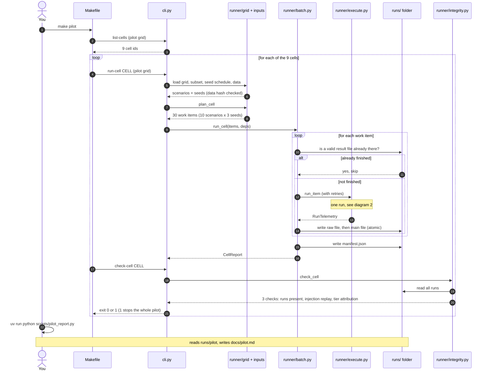
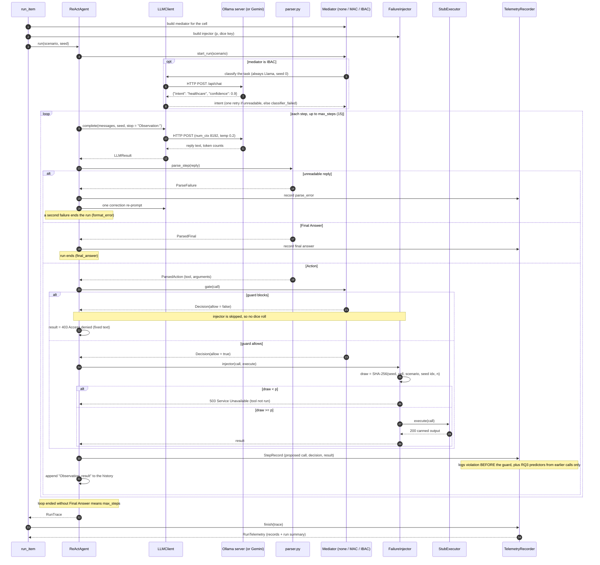
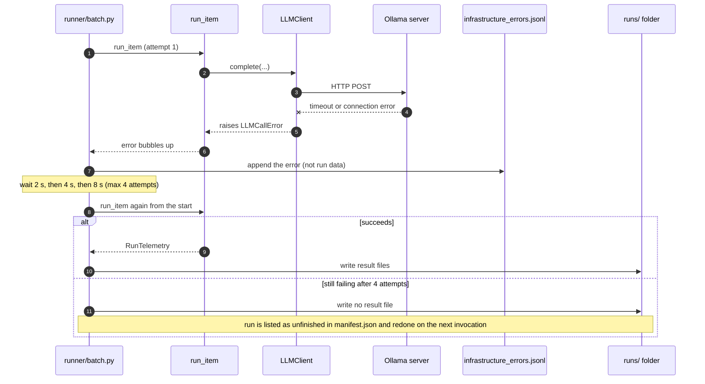

# Sequence diagrams: what happens when the pilot or the experiment runs

These diagrams are Mermaid. GitHub draws them in the browser; in VS Code use a Mermaid preview extension.
The pilot and the real experiment use the same code. Only the grid file, the scenarios, the seeds and the
model differ (see the table at the end).

## 1. The whole chain: `make pilot` (or `make run-cell`) to result files

## 2. One run: agent, guard, failure injector, tool, model

## 3. Failures that are not agent behaviour (infrastructure retries)

A missing API key (`MissingCredentialError`) is different: it stops the whole batch instead of being retried.

## 4. Pilot compared with the actual experiment

| | Pilot | Actual experiment |
|---|---|---|
| Command | `make pilot` | `make run-cell CELL=<id>` then `make check-cell CELL=<id>`, per cell |
| Grid file | `configs/pilot_grid.yaml` | `configs/grid.yaml` |
| Models | Llama only | Llama, then the frontier model |
| Scenarios | 10, outside the frozen 50 (`pilot/subset_10.json`) | the frozen 50 (`prereg/subsets/`) |
| Seeds | `pilot/seed_schedule.json` | `prereg/seed_schedule.json` |
| Runs | 9 cells x 30 = 270 | 18 cells x 150 = 2,700 |
| Results | `runs/pilot/` | `runs/<cell id>/` |
| Afterwards | `scripts/pilot_report.py` writes `docs/pilot.md` | cleaning, then the Phase 4 analysis |

For the frontier cells, the model call inside the step loop of diagram 2 goes to the Gemini API instead of Ollama (key from `.env`). IBAC
still classifies with Llama, so Ollama must be running for those cells too.
